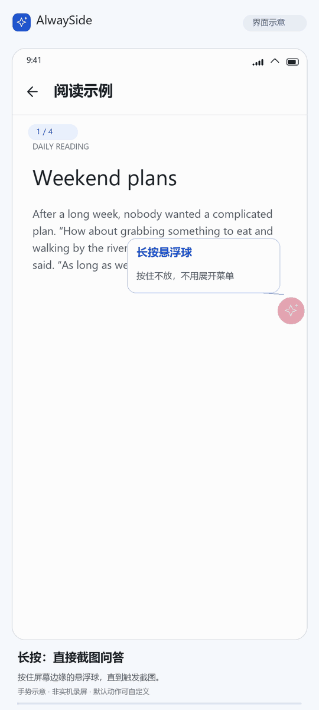
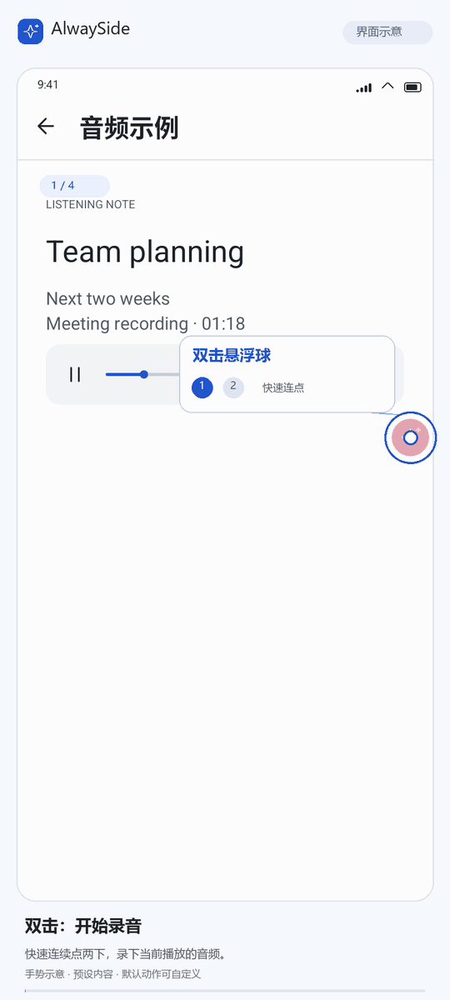

# AlwaySide

AlwaySide 是一款 Android 悬浮 AI 助手。你可以对屏幕内容、应用正在播放的声音或选中的文字提问，并在悬浮窗或应用内继续对话。

[使用说明](docs/usage.md)

## 适用设备与使用条件

应用支持 Android 10（API 29）及以上。使用 AI 功能前，所有设备都需要在应用设置中配置兼容的 API 服务地址、密钥和模型。服务是否收费及具体费用由服务提供方决定。

## 可以做什么

- **截图提问**：截取整个屏幕或框选区域，翻译、解释或总结画面内容，也可以继续追问。
- **音频转写**：录制应用内播放的声音，查看转写、翻译，或根据转写内容提问。
- **文字提问**：从系统文字选择菜单或分享入口发送文字。
- **接续对话**：在悬浮窗和应用内聊天之间继续会话，也可以从历史记录中接着提问。
- **按需调整**：自定义快捷手势、截图和音频提示词、模型及生成参数；悬浮窗支持移动、缩放和固定。

## 界面与使用演示

以下为界面与操作示意，内容为演示样例；录音和回答生成过程经过压缩。点击图片可查看大图。

  
  

**长按截图，翻译后继续追问。** **双击录音，结束后查看原文与翻译。**

## 开始使用

1. 从[最新 Release](https://github.com/Always1010/AlwaySide/releases/latest)下载 APK 并安装。
2. 在「设置 → 服务商与密钥」中添加服务接入点与命名密钥，再到「模型与服务 → 图文问答」建立配置，选择接入点、密钥、模型及用途参数，保存后显式设为当前。需要录音时，再独立建立并启用「音频转写」配置；两用途可共用或分开使用服务与密钥。
3. 按需授予悬浮显示、截图或内部录音权限，然后在首页开启悬浮助手。
4. 点击悬浮球开始截图提问或录音。也可以直接在应用内聊天。

支持 Responses、Chat Completions、Gemini 原生 GenerateContent 和 Claude Messages 流式接口。截图提问需要模型支持图片输入；音频使用独立的 OpenAI 兼容文件转写接口，可以与另一家问答服务组合。各模型的推理、搜索和采样能力不同。配置步骤见[使用说明](docs/usage.md)，协议、请求格式和兼容边界见[API 服务商与接口格式](docs/api-providers.md)。

首次使用可以先在首页选择「开始体验」，练习截图和追问。体验内容使用内置示例，不会调用 API 或产生 Token 费用，也不会测试你配置的服务。

## 数据与权限

API 密钥加密保存在本机。提问时，相关文字、截图或录音会发送到你配置的 API 服务；请确认该服务可信。屏幕共享期间应用不会持续上传画面。

会话保存在本机，截图和音频默认随会话长期保存，可在「设置 → 历史与媒体」中分别关闭。删除会话时，关联的图片和音频也会一并删除。

悬浮显示、截图和内部录音受 Android 系统及目标应用限制。应用不会绕过这些限制；内部录音失败时也不会改用麦克风。

## 更多说明

- [完整使用说明](docs/usage.md)：API 配置、权限、截图与录音操作、常见问题。
- [图片、音频与会话](docs/ai-media-context.md)：媒体发送、对话上下文和本地保存规则。
- [构建与开发](apps/android/README.md)：开发环境、本地构建和 GitHub Release 流程。
