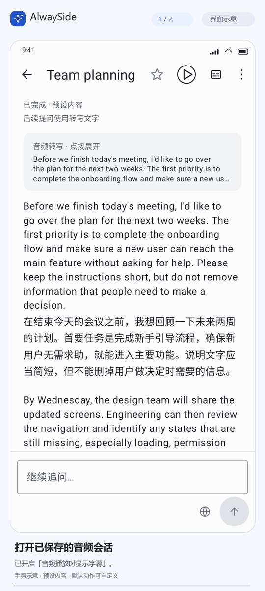
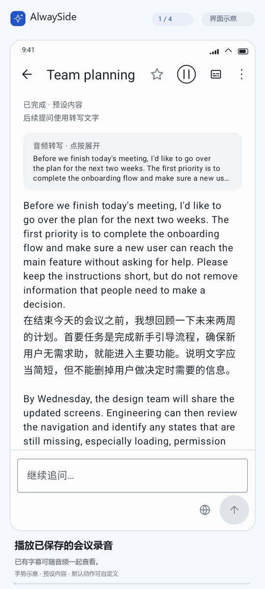

# AlwaySide

AlwaySide 是一款可自定义的 Android 悬浮 AI 助手。你可以截取屏幕、选中文字或录制应用内音频，让你配置的 AI 服务翻译、解释、总结，并在悬浮窗中继续追问。翻译与语言理解是主要场景之一；通过提示词、快捷动作和悬浮菜单，也可以让常用操作更贴合自己的使用习惯。

[使用说明](docs/usage.md)

## 适用设备与使用条件

应用支持 Android 10（API 29）及以上。应用作为 AI 客户端，不提供 API 服务、密钥或调用额度。使用 AI 功能前，请自行准备可用的 API 服务，并在应用中配置服务地址、密钥和模型。

## 主要场景

- **读懂外语内容**：截图或选择文字翻译，再追问词义、语气、句子结构和上下文。
- **解释当前画面**：截取整屏或框选区域，请助手解释图表、界面提示或画面中的信息。
- **整理一段音频**：录制应用内播放的声音，转写、翻译、总结或提取要点，之后围绕原文继续提问。
- **按自己的方式处理**：为截图、选中文字和音频设置默认问题，保存提示词模板，配合自定义菜单、快捷手势及模型使用。
- **接着聊、以后再看**：在悬浮窗和应用内聊天之间继续会话，从历史或收藏中恢复讨论；悬浮窗支持移动、缩放和固定。

实验室还提供字幕制作、聊天点读和长按滑动，默认关闭。字幕制作目前面向英语录音与简体中文译文，已有字幕可在回听时对照查看。实验功能的配置与限制见[使用说明](docs/usage.md#实验功能)。

## 界面与使用演示

以下演示使用预设内容，展示主要操作与界面。点击图片可查看大图。

  
  

**截图翻译，并结合画面继续追问。** **录制应用内音频，查看转写与翻译。**

  
  

**回听已保存录音，通过字幕浮窗查看内容。** **对照双语字幕，点击字幕重听对应片段。**

## 开始使用

1. 从[最新 Release](https://github.com/Always1010/AlwaySide/releases/latest)下载 APK 并安装。
2. 在「设置 → AI 服务」中配置自己的 API 密钥和模型；处理录音时，另行配置转写服务。
3. 开启悬浮助手，按提示授予所需权限。
4. 默认长按截图、双击录音，或直接进入应用内聊天。

配置步骤见[使用说明](docs/usage.md#连接-api-服务)，支持的服务与接口要求见[API 服务商与接口格式](docs/api-providers.md)。

首次使用可先体验应用内引导，了解截图、录音和追问操作。引导使用内置示例，无需配置 API，也不会产生调用费用。

## 数据与权限

API 密钥加密保存在本机。提问时，相关文字、截图或录音会发送到你配置的 API 服务；请确认该服务可信。屏幕共享期间应用不会持续上传画面。

使用聊天点读时，所选文字会发送到朗读服务。已有点读音频可从本地缓存重播。实验字幕制作会另行上传所选录音与字幕文字，操作前会提示费用。

会话保存在本机，截图和音频默认随会话长期保存，可在「设置 → 历史与媒体」中分别关闭。删除会话时，关联的图片和音频也会一并删除。

悬浮显示、截图和内部录音受 Android 系统及目标应用限制。应用不会绕过这些限制；内部录音失败时也不会改用麦克风。

## 更多说明

- [完整使用说明](docs/usage.md)：API 配置、权限、截图与录音操作、常见问题。
- [图片、音频与会话](docs/ai-media-context.md)：媒体发送、对话上下文和本地保存规则。
- [构建与开发](apps/android/README.md)：开发环境、本地构建和 GitHub Release 流程。
