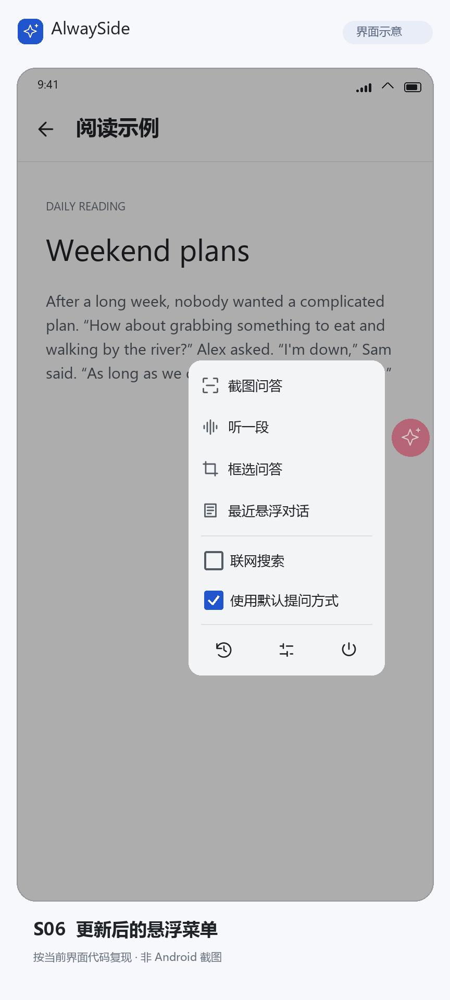
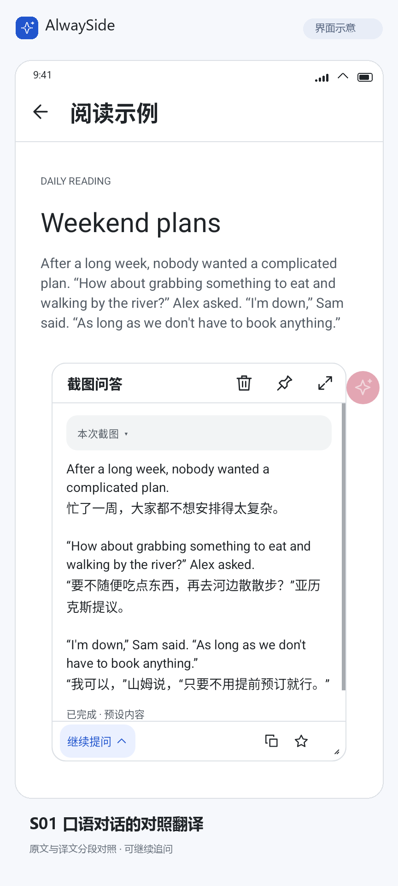
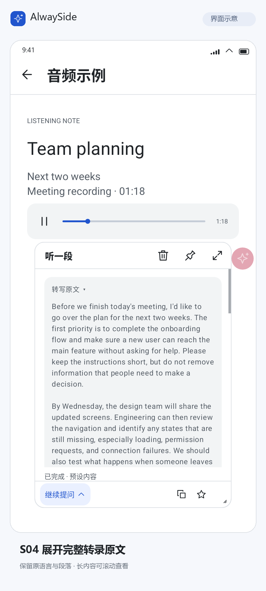
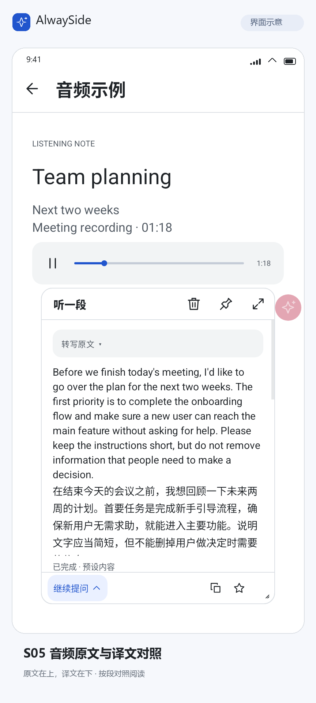
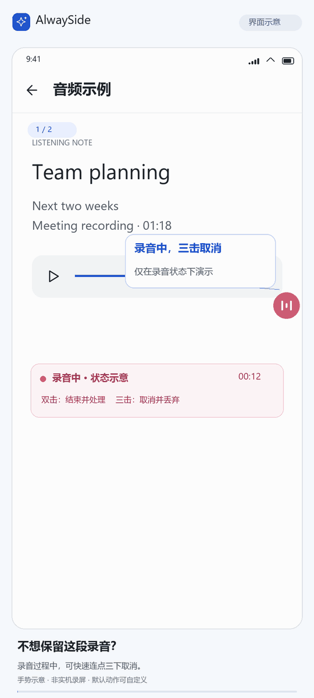
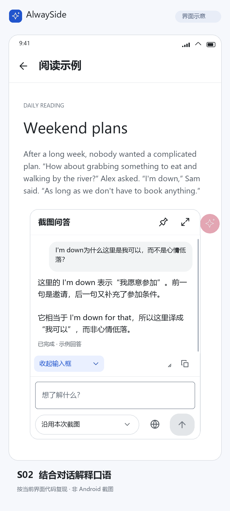

# AlwaySide 使用说明

长按截图、双击录音的完整动图见 [README 的界面与使用演示](../README.md#界面与使用演示)。本文配图为界面示意，使用预设演示内容；点击图片可查看大图。

## 新手引导

首次打开可在首页选择「开始引导」，进入四项引导目录：单击展开菜单并截图追问、长按直接截图、双击开始和结束录音、三击取消录音。引导按默认手势教学，每项可单独选择，完成情况会保留；右上角的更多图标可切换到其他引导。

引导中的悬浮球、菜单、结果小窗和输入区与真实助手共用界面组件。当前操作目标保持原色，外有高对比描边和指示箭头；按提示单击、连续点按或长按小球。截图后可从小窗左下角展开「继续提问」，点输入框填入示例问题，再点击下方的发送箭头。录音引导仅显示模拟状态和预设转写，不播放或录制音频。

这段引导完全在应用内运行，画面、问题和回答都是内置示例：不截取真实屏幕、不录音、不调用 API、不消耗 Token，不需要填写密钥或授予系统权限，也不会进入普通聊天历史。已配置密钥时，引导同样不会使用它。引导不提供自由对话。

随时可退出，中断后首页可继续；跳过后不会反复邀请。进入「设置 → 帮助与引导」可继续未完成的引导，或在完成后重新查看。为避免误点真实操作，已有真实悬浮球运行时，请先在首页主动关闭，再开始引导。

帮助页的「新手引导」和「准备实际使用」始终可见、可点击。未完成四项引导时，新手引导使用蓝色主按钮，实际准备使用有底色和边框的次要按钮；完成后再以蓝色突出实际准备，不强制限制进入设置。新手引导内部的「了解如何追问」、主要的「完成本项」、完成页主按钮和模拟发送按钮也统一使用蓝色；灰底次要按钮保持原样，不改变全局主题或真实聊天、小窗的按钮配色。

完成后选择「准备实际使用」，按四项列表添加 API 密钥、添加图文问答服务，首项自动选中，之后点击服务行切换、可选添加并选用音频转写服务，最后开启悬浮助手并按需授权和实际测试；当前建议操作会显示「下一步」。API 和费用说明可点右上角问号查看。配置页返回准备页，准备页再返回帮助与引导，顶部返回与系统返回一致。引导完成只表示已看过操作流程，不代表服务已配置或验证成功。

## 连接 API 服务

服务商名称统一使用 Qwen。请使用所选 Qwen 接入点对应地域的 API 地址和 API Key。

1. 点击首页设置图标，进入「AI 服务」。页面只显示「配置问答服务」「配置转写服务」「管理 API 服务」三个入口。前两个入口下方的小字显示当前选用的「服务商 · 密钥名称 · 模型」，未选用配置时显示「未配置」。
2. 打开「管理 API 服务」，使用添加图标先选服务商，再填写 Key 与名称。内置 OpenAI、DeepSeek、Qwen、Gemini、Claude 和自定义服务商；管理页按实际服务商分组，直接列出已命名的 Key，每条 Key 同时保存 API 地址与接口信息。Key 的添加和编辑都在此页完成。
3. 按服务提供方要求调整该 Key 的 HTTPS **基础地址**，不附带 `/responses`、`/chat/completions` 等请求路径。OpenAI 常用 `/v1`，DeepSeek 使用根地址，Gemini 原生使用 `/v1beta`；无需把所有地址改成 `/v1`。Qwen 地址和 Key 的地域、业务空间必须匹配。
4. 打开「配置问答服务」，使用添加图标依次选择服务商、该服务商已有的 Key、模型及默认参数。新建配置首次选定可用 Key 后，按服务商和当前接口填入内置默认模型；OpenAI 图文问答默认使用 `gpt-6-luna`。点击「模型」可离线选择精简推荐项，也可「手动填写」模型 ID 或主动「从服务获取」模型列表；截图问答需要模型支持图片输入。每个服务商在每个用途中只保留一张卡片，不另填配置名称；通过列表行尾图标编辑或删除已有服务。
5. **首项保存后自动选中，后续新增不切换。** 列表左侧圆框表示唯一选中项，点击服务行即可切换；行尾可编辑或删除已有服务。选用时不会发送测试请求。
6. 使用录音时，在「配置转写服务」独立添加并选用卡片，依次选择服务商、已有 Key、转写模型及该用途支持的默认参数。**音频转写仅 OpenAI 提供内置推荐，默认 `gpt-transcribe`；其他服务商的转写默认值和推荐列表均为空。** 两用途可共用同一服务与 Key，也可分别使用不同服务或同服务的不同 Key。转写需要目标服务实际提供本客户端支持的 OpenAI 兼容文件转写接口；聊天协议兼容不代表支持转写。未设置转写不影响截图与文字；「仅原始转写」不需要问答 Key，翻译或回答才需要图文问答卡片。
7. 开启悬浮助手并按需授予权限，再主动测试或实际提问。文字、本地示例图片和搜索分别验证；图片测试不会截取真实屏幕。读取模型列表、实际测试和提问会联网，可能产生费用。

| 服务 | 默认接口 | 地址说明 |
| --- | --- | --- |
| OpenAI | Responses | `https://api.openai.com/v1` |
| DeepSeek | Responses | `https://api.deepseek.com` |
| Qwen | Chat Completions | 默认北京兼容地址；其他地域或业务空间使用控制台给出的 `/compatible-mode/v1` 基础地址 |
| Gemini | 原生 GenerateContent | `https://generativelanguage.googleapis.com/v1beta` |
| Claude | Messages | `https://api.anthropic.com/v1`；按账户需要填写 Workspace ID，API 版本默认 `2026-10-21` |

高级协议选择支持 Gemini 的 OpenAI 兼容 Chat，地址必须改为 `https://generativelanguage.googleapis.com/v1beta/openai`；此模式当前不开放搜索和回答详细程度。Qwen可在模型明确支持时选用 Responses。接口格式和完整限制见[API 服务商与接口格式](api-providers.md)。

旧版单连接设置截图 S07／S08 保留在素材目录，但不在本文展示；新版「AI 服务」界面尚未重新截图。服务地址和模型 ID 请使用提供方给出的值。

保存配置不会自动发送测试请求。模型配置中的模型列表操作会向服务发起真实网络请求，请按需主动使用。真实文字或截图提问会调用你配置的 API，可能产生费用；模拟引导不会验证真实服务。

音频转写配置可主动进行独立的静音 WAV 接口诊断。它会调用所选转写服务，可能产生费用；诊断只检查接口兼容性，不能证明真实语音识别准确。

内置推荐无需联网，不代表当前账户有权限使用。没有推荐项表示应用暂未收录适合当前用途和接口的型号，仍可手动填写或主动获取。推荐更新只影响之后新建的配置，编辑已有配置、更换 Key、重新进入页面或升级应用都不会覆盖用户保存的型号；主动获取列表也不会自动换模型，必须点选后才写入草稿。

应用支持四种流式协议；模型出现在远端列表中，只说明列表接口可访问，不代表该模型的图片、搜索或转写能力已经验证。文字、图片和搜索分别测试；搜索测试仅在返回实际搜索元数据时确认执行，Qwen Chat 不提供这类元数据，所以请求完成也不会标记为搜索已验证。

密钥按名称和掩码展示，不显示完整凭证。替换 Key 后需要重新确认模型访问权限及测试结果。删除被卡片引用的 Key 前，请检查受影响的用途；删除后受影响用途会显示未配置，不会自动换用其他服务。本版不迁移旧版 v1–v3 的服务配置，首次升级会提示重新配置服务；历史记录、媒体、提示词及外观设置保留。

推理程度、回答详细程度、输出上限和联网搜索按模型能力提供，不确定时选择“不设置”。参数保存在各用途的服务商卡片中；图文问答和音频转写的参数互不覆盖。参数值由所选协议和模型适配，不代表任意服务都支持相同取值。更换模型时应确认不兼容参数的处理，不确定时留空使用服务默认。Claude 当前 API 版本不接受 Temperature/Top P，输出上限留空时应用使用 8192。Gemini 的 none 与 minimal 不等价，部分模型不能关闭思考；DeepSeek 的图像与搜索能力也随模型不同。已知不支持的参数会明确提示，不会自动删掉参数后重新请求。搜索可能增加费用，开启表示允许模型搜索，不保证每次执行；Qwen Chat 搜索不返回结构化来源。

点击服务行切换服务只影响后续发送；继续已有对话时，相关文字上下文会发送给新选择的服务。正在执行的请求保留发送时的配置快照。失败后由你主动重试，不自动换厂商、换模型或关闭搜索；移除、删除或更新凭证后，旧请求需要重新发送。Claude 搜索暂停时，重试按钮显示“继续生成”，点击会再次调用原服务，最多继续 3 次。

## 打开或关闭悬浮助手

实际使用时主动开启悬浮助手，再按提示允许悬浮显示；首次打开不会自动跳到权限设置。之后可通过首页的悬浮球开关打开或关闭。主动关闭后，应用会记住这一选择。普通文字聊天和查看历史不需要悬浮权限。

截图或录音时，应用会按需申请系统权限；允许后继续刚才的操作，拒绝或取消则不会开始采集。系统结束屏幕共享后，下次采集会重新请求授权。

默认手势如下，也可在「设置 → 快捷动作」中修改：

| 操作 | 空闲时 | 录音时 |
| --- | --- | --- |
| 单击 | 展开菜单 | 展开菜单 |
| 双击 | 开始录音 | 结束并处理 |
| 三击 | 框选问答 | 取消并丢弃录音 |
| 长按 | 截图问答 | 不可截图，请先结束或取消录音 |

拖动可移动悬浮球。

### 长按滑动（可选）

在「设置 → 快捷动作」开启「长按滑动」，可在原有手势之外使用长按后上移、下移和向屏幕内侧移动。默认关闭；关闭时长按仍按系统时长直接触发。

开启后，按住小球，外圈填满时轻震并展开圆形功能图标。默认长按等待为 0.6 秒，滑动距离为 24dp，动作圆直径为 32dp；三项都可调整，系统无障碍长按时间更长时沿用更长的时间。动作圆大小独立于悬浮球大小，滑动距离只是方向预选门槛，不必拖到动作圆中心。小球上下会预留动作圆展开空间，保持上、下、向内的位置与滑动方向一致。

普通模式在长按成立时也提供一次短触觉反馈；长按滑动在就绪时反馈一次，松手不重复。震动遵循系统触觉设置、设备支持与后台限制，系统不允许震动时仍可使用视觉反馈。

- 提示出现后，未向任何方向滑出时原地松手，触发长按功能。
- 提示出现后向上、下或内侧移动到有效距离，预选该方向功能，松手执行。
- 已滑出后回到中心松手，取消本次选择。
- 持续按住不会自动执行，没有倒计时。
- 提示出现前就直接拖动，仍然只移动悬浮球。一旦开始移动球，停住也不会变成长按。

每次触摸只确认一个动作。向外移动或被系统中断会取消本次选择；未分配的方向松手不执行，也不会回退执行长按。屏幕边缘动作仍可能受设备的系统返回手势影响。

三个方向始终保留位置，空心虚线圆表示未设置。某个方向只在另一种录音状态可用时，会保留功能图标并显示简短的不可用原因，当前状态松手不执行。

「快捷动作」顶部的「拓展选项」管理长按滑动；关闭时不显示等待、距离、动作圆大小、三个方向选项或方向绑定摘要。滑动距离可选 16–40dp，动作圆直径可选 28–40dp，均按 4dp 调整。三个方向默认均未分配，开启不会自动绑定；关闭后保留已设置的方向绑定。

功能列表只提供截图问答、框选问答、开始录音、结束录音、取消并丢弃录音和展开菜单。点开功能，直接勾选一个或多个手势并保存；取消不改变绑定。设置、对话记录和最近悬浮对话仅作为悬浮菜单入口，不提供快捷绑定。

程序自动判断是否可以共用手势：截图问答、框选问答与开始录音彼此互斥；结束录音与取消并丢弃录音互斥；两组之间可以共用；展开菜单独占手势。冲突选项置灰且不能勾选，点击灰色行只显示短暂的占用原因提示，不修改绑定或关闭面板。开始与结束录音可共用双击，框选与丢弃录音可共用三击，无需手动设置录音条件。要改用被占用的手势，请先在原功能取消绑定；恢复默认仅恢复基础绑定并清空方向分配，不改开关、等待、距离或动作圆大小。

点击开关旁的 ⓘ 查看说明，再点「体验」，可观看示范并亲自练习长按松手、三个方向和回中取消。练习复用真实球的反馈和动作判定，但不会截图、录音、联网或修改绑定，不需要 API 或采集权限。已有真实悬浮球运行时，请先在首页关闭，避免误触真实功能。

### 悬浮菜单与提问选项

单击悬浮球展开菜单，点击菜单外部可收起。菜单提供截图、框选和录音入口，不必记住所有手势。

  
   
  空闲状态下的悬浮菜单；有可回听音频时还会显示“回听上一段”。

菜单在「最近悬浮对话」下方提供两个复选项，切换后菜单保持打开，并记住选择：

- **联网搜索**：控制随后新建的悬浮会话是否使用网页搜索；首次沿用设置中的默认值。关闭网页搜索后，调用模型仍需要网络。已有会话可在自己的输入区单独切换。
- **使用默认提问方式**：开启时按截图、音频或选中文字各自的默认设置处理；关闭时，采集完成后打开结果小窗、展开并聚焦问题输入框，唤起键盘，等你补充问题再发送。菜单和快捷手势共用此选择，设置页原有的分项选项不会被改写。

菜单底部一排图标分别打开对话记录、设置和关闭悬浮球，长按图标可查看说明。

## 截图与框选

长按悬浮球截取整屏，或从菜单选择框选，只发送选中的区域。默认会使用预设问题自动提问；关闭默认提问或截图自动提问后，小窗会自动展开并聚焦输入框，补充问题后再发送。

  
   
  截图后，在小窗中阅读当前画面的中文翻译。

继续提问时可选择：

- **沿用原图**：继续讨论当前图片。
- **更新画面**：发送时重新截图，适合页面内容已经变化的情况。
- **仅文字**：保留前面的文字讨论，本轮不附图片。

框选后更新画面会沿用选区；屏幕方向或大小变化时需要重新框选。联网搜索可在当前会话中单独切换。

## 录音、转写与翻译

双击悬浮球开始录制应用内播放的声音，再次双击结束并处理。录音期间三击可取消，取消的录音会直接丢弃，不发送转写。录音中需要截图时，请先结束或取消录音。

关闭「使用默认提问方式」或录音自动处理后，手动结束录音会先打开并聚焦问题输入框，不会自动上传。输入问题并发送后，先转写录音，再按你的问题回答；本次手动问题优先于音频默认的「仅原始转写」或「中文翻译」模式。录音上限的丢弃和确认策略继续生效；关闭总开关时，「自动处理录音」也会改为等待补充问题，确认保留录音后仍需手动发送。

  
  

点击「转写原文」可展开完整转录；收起原文后，继续阅读中文翻译。较长的原文和译文都可以滚动查看。

每张音频转写卡片独立保存转写提示和语言。提示词页的「新转写配置的默认提示」只用于之后新建转写配置的初始值；修改它或应用提示词模板不会改变已有转写配置。要调整当前转写行为，请编辑对应音频转写配置并保存。

在「设置 → 提示词」中选择音频默认输出：

| 方式 | 得到的内容 |
| --- | --- |
| 仅原始转写 | 录音转成的原语言文字 |
| 原文 + 中文翻译 | 可展开的转写原文，以及中文翻译 |
| 原文 + 按音频问题回答 | 可展开的转写原文，以及按预设问题生成的回答，例如总结或提取要点 |

转写完成后，可以围绕原文继续追问，无需再次上传录音。关闭音频自动处理后，结束录音会先等待你输入问题。

### 取消本次录音

录音中快速连续点击悬浮球三次，可取消并丢弃本段录音。取消后不会发送转写请求。

  
   
  三击取消录音。触点和状态提示为教学示意。

### 录音时长与到限处理

录音默认上限为 10 分钟，可在「设置 → 历史与媒体」中调整，并选择「达到上限后」的处理方式：

- **丢弃录音（默认）**：停止并删除本段录音，不保存到历史、不发起转写，防止忘记结束录音而产生意外用量。
- **保留录音并提示**：停止并打开语音小窗，等待你选择「转写」或「丢弃」。收起窗口不会自动发送，可从小球菜单的最近悬浮对话重新打开；再次开始录音也会先提醒处理上一段。确认转写前仅暂存在当前悬浮会话，停止助手或应用进程退出后不保留。
- **自动处理录音**：停止后直接按音频默认输出转写、翻译或回答。

上限及处理方式的修改从下一段录音生效。手动结束仍遵循音频自动处理开关。填 `0` 表示不设时长上限，不触发时长上限处理；仍受可用存储空间和 WAV 文件约 2 GiB 限制，达到文件大小限制时也按所选方式处理。较长录音会分段转写后合并原文。应用只采集开始录制之后的声音，不录制麦克风。

## 选中文字提问

在其他应用中选中文字，点击系统菜单中的「询问 AlwaySide」，入口可能位于更多菜单中；也可将纯文本分享到 AlwaySide。部分应用使用自定义文字菜单，可能不显示此入口。

助手会保留所选原文供追问参考。没有悬浮权限时，会打开应用内聊天。

## 小窗、聊天与历史

拖动小窗标题栏可移动窗口，拖动底部操作行中的缩放图标可调整大小；缩放图标位于复制按钮左侧，复制按钮靠右对齐。标题栏的五角星可收藏或取消收藏当前会话，实心表示已收藏。未固定时点击窗口外收起；点击图钉固定后，小窗会保持显示。收起窗口不会删除会话，也不会取消正在生成的回答。

小窗追问输入区默认收起，点击左下角的「继续提问」及小箭头展开，展开后点击「收起输入框」可收起；入口与复制按钮共用一排。收起会保留未发送的草稿，有草稿时入口显示「继续编辑」并高亮。在设置的「结果窗口」中关闭「小窗口追问输入框默认收起」，可让下次呼出时直接显示输入区。

  
   
  围绕同一段对话继续追问，发送后在小窗中查看新的回答。

小窗标题栏的展开图标可进入应用内的当前聊天，继续查看回答或输入问题。首页加号可新建文字对话，点击历史记录可继续已有对话。长按记录进入多选，再使用删除图标清理所选会话。

首页左上角菜单可打开侧边抽屉，进入「全部对话」「我的收藏」或指定收藏标签；设置入口位于首页右上角。聊天页的五角星图标可收藏或取消收藏，历史多选也可批量操作。收藏会话可从聊天页的更多菜单设置多个标签；抽屉中可新建、重命名或删除标签，删除标签不会删除会话。「我的收藏」始终包含所有收藏，支持搜索标题、正文和标签。

普通历史默认保留 500 段，可在「设置 → 历史与媒体 → 普通历史上限」调整。收藏不计入数量上限，也不会被自动淘汰。取消收藏后会重新进入普通历史队列的最新位置，原聊天日期和已有标签保持不变；调低数量上限时会先确认将删除的普通历史数量。

默认随历史保存截图，可点击图片放大查看，也可在「历史与媒体」中关闭保存。未保存原图的记录仍可继续文字讨论，需要看图时请重新截图。

「设置 → 历史与媒体」中的「随历史长期保留音频」默认开启，可按需关闭。开启时，新完成的录音会随会话保存，无论是否已经转写；打开历史对话，点击标题栏的播放图标即可回听，再次点击可暂停或继续。图标外围的细圆环表示剩余音频，从顶部沿顺时针方向逐渐消失，暂停时保持，播完后恢复播放图标，再次点击从头回听。播放时可自由翻看聊天、复制文字和发送追问；离开聊天页时停止播放。不提供拖动进度。尚未转写的已保存录音也可以发送问题后处理。关闭开关不删除旧音频，重新开启也不会补存之前的录音。取消录音仍直接丢弃，删除会话会同时删除音频。转写文字始终随会话保留。详细说明见[图片、音频与会话](ai-media-context.md)。

## 常见问题

**悬浮球不见了**：检查应用首页的悬浮球开关，以及系统是否仍允许悬浮显示。

**无法截图或录不到声音**：确认已授予权限；目标应用也可能禁止采集。内录失败时不会自动改用麦克风。

**模型或参数报错**：检查服务地址、密钥、模型用途及可选参数是否受支持。模型列表能读取，并不代表图文和转写接口均可用。

**希望修改默认提问或操作方式**：在设置中调整提示词、手势和窗口行为；悬浮球外观、应用主题也可分别调整。
