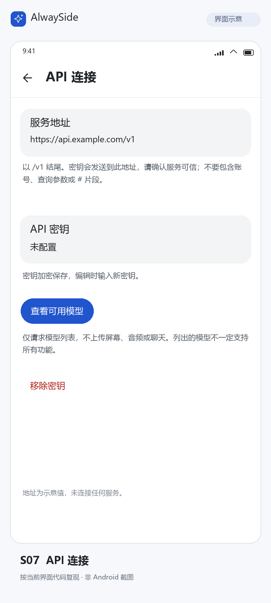
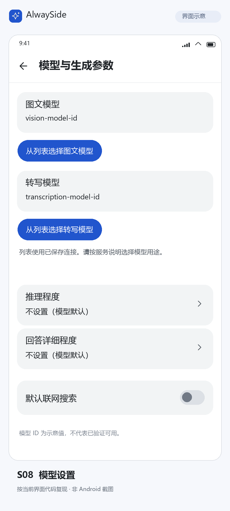

# AlwaySide 使用说明

长按截图、双击录音的完整动图见 [README 的界面与使用演示](../README.md#界面与使用演示)。本文配图为界面示意，使用预设演示内容；点击图片可查看大图。

## 新手引导

首次打开可在首页选择「开始引导」，进入四项引导目录：单击展开菜单并截图追问、长按直接截图、双击开始和结束录音、三击取消录音。引导按默认手势教学，每项可单独选择，完成情况会保留；右上角的更多图标可切换到其他引导。

引导中的悬浮球、菜单、结果小窗和输入区与真实助手共用界面组件。当前操作目标保持原色，外有高对比描边和指示箭头；按提示单击、连续点按或长按小球。截图后可从小窗左下角展开「继续提问」，点输入框填入示例问题，再点击下方的发送箭头。录音引导仅显示模拟状态和预设转写，不播放或录制音频。

这段引导完全在应用内运行，画面、问题和回答都是内置示例：不截取真实屏幕、不录音、不调用 API、不消耗 Token，不需要填写密钥或授予系统权限，也不会进入普通聊天历史。已配置密钥时，引导同样不会使用它。引导不提供自由对话。

随时可退出，中断后首页可继续；跳过后不会反复邀请。进入「设置 → 帮助与引导」可继续未完成的引导，或在完成后重新查看。为避免误点真实操作，已有真实悬浮球运行时，请先在首页主动关闭，再开始引导。

帮助页的「新手引导」和「准备实际使用」始终可见、可点击。未完成四项引导时，新手引导使用蓝色主按钮，实际准备使用有底色和边框的次要按钮；完成后再以蓝色突出实际准备，不强制限制进入设置。新手引导内部的「了解如何追问」、主要的「完成本项」、完成页主按钮和模拟发送按钮也统一使用蓝色；灰底次要按钮保持原样，不改变全局主题或真实聊天、小窗的按钮配色。

完成后选择「准备实际使用」，按三项列表填写服务地址与密钥、选择图文模型、开启悬浮助手；当前建议操作会显示「下一步」。API 和费用说明可点右上角问号查看。配置页返回准备页，准备页再返回帮助与引导，顶部返回与系统返回一致。引导完成只表示已看过操作流程，不代表服务已配置或验证成功。

## 连接 API 服务

1. 点击首页的设置图标，进入「API 连接」，填写服务地址和 API 密钥。地址使用 HTTPS，并以 `/v1` 结尾。
2. 在「模型与生成参数」中选择图文模型；使用录音转写时，还需选择转写模型。可读取服务的模型列表，也可手动填写模型 ID。
3. 返回首页，通过新建文字对话或截图提问确认连接可用。

  
  

连接信息与模型配置示例。图中的服务地址和模型 ID 为示意值，请使用服务提供方给出的实际地址和模型名称。

保存配置不会自动发送测试请求。设置中的「查看可用模型」和模型列表选择会向服务发起真实网络请求，请按需主动使用。真实文字或截图提问会调用你配置的 API，可能产生费用；模拟引导不会验证真实服务。

服务需要支持 Responses 流式请求；截图问答还需要模型支持图片输入，音频转写需要文件转写接口。仅支持 Chat Completions 的服务无法使用当前问答流程。模型出现在列表中，不代表支持全部功能，请按所用服务说明选择。

密钥保存后不回显。更换时输入新密钥并保存，删除时使用「移除密钥」。服务地址决定密钥和提问内容发送到哪里，请确认填写正确。

推理程度、回答详细程度、输出上限和联网搜索均可按需调整。不确定时先保留现有设置；如果服务提示参数不支持，再关闭或调整相应选项。联网搜索需要服务和模型支持，可能增加费用。

## 打开或关闭悬浮助手

实际使用时主动开启悬浮助手，再按提示允许悬浮显示；首次打开不会自动跳到权限设置。之后可通过首页的悬浮球开关打开或关闭。主动关闭后，应用会记住这一选择。普通文字聊天和查看历史不需要悬浮权限。

截图或录音时，应用会按需申请系统权限；允许后继续刚才的操作，拒绝或取消则不会开始采集。系统结束屏幕共享后，下次采集会重新请求授权。

默认手势如下，也可在「设置 → 手势」中修改：

| 操作 | 空闲时 | 录音时 |
| --- | --- | --- |
| 单击 | 展开菜单 | 展开菜单 |
| 双击 | 开始录音 | 结束并处理 |
| 三击 | 框选问答 | 取消并丢弃录音 |
| 长按 | 截图问答 | 提示先结束或取消录音 |

拖动可移动悬浮球。菜单也提供截图、框选和录音入口，不必记住所有手势。

菜单在「最近悬浮对话」下方提供两个复选项，切换后菜单保持打开，并记住选择：

- **联网搜索**：控制随后新建的悬浮会话是否使用网页搜索；首次沿用设置中的默认值。关闭网页搜索后，调用模型仍需要网络。已有会话可在自己的输入区单独切换。
- **使用默认提问方式**：开启时按截图、音频或选中文字各自的默认设置处理；关闭时，采集完成后打开结果小窗、展开并聚焦问题输入框，唤起键盘，等你补充问题再发送。菜单和快捷手势共用此选择，设置页原有的分项选项不会被改写。

菜单底部一排图标分别打开对话记录、设置和关闭悬浮球，长按图标可查看说明。

## 截图与框选

长按悬浮球截取整屏，或从菜单选择框选，只发送选中的区域。默认会使用预设问题自动提问；关闭默认提问或截图自动提问后，小窗会自动展开并聚焦输入框，补充问题后再发送。

  
   
  截图后，在小窗中阅读当前画面的中文翻译。

继续提问时可选择：

- **沿用原图**：继续讨论当前图片。
- **更新画面**：发送时重新截图，适合页面内容已经变化的情况。
- **仅文字**：保留前面的文字讨论，本轮不附图片。

框选后更新画面会沿用选区；屏幕方向或大小变化时需要重新框选。联网搜索可在当前会话中单独切换。

## 录音、转写与翻译

双击悬浮球开始录制应用内播放的声音，再次双击结束并处理。录音期间三击可取消，取消的录音会直接丢弃，不发送转写。录音中需要截图时，请先结束或取消录音。

关闭「使用默认提问方式」或录音自动处理后，手动结束录音会先打开并聚焦问题输入框，不会自动上传。输入问题并发送后，先转写录音，再按你的问题回答；本次手动问题优先于音频默认的「仅原始转写」或「中文翻译」模式。录音上限的丢弃和确认策略继续生效；关闭总开关时，「自动处理录音」也会改为等待补充问题，确认保留录音后仍需手动发送。

  
  

点击「转写原文」可展开完整转录；收起原文后，继续阅读中文翻译。较长的原文和译文都可以滚动查看。

在「设置 → 提示词」中选择音频默认输出：

| 方式 | 得到的内容 |
| --- | --- |
| 仅原始转写 | 录音转成的原语言文字 |
| 原文 + 中文翻译 | 可展开的转写原文，以及中文翻译 |
| 原文 + 按音频问题回答 | 可展开的转写原文，以及按预设问题生成的回答，例如总结或提取要点 |

转写完成后，可以围绕原文继续追问，无需再次上传录音。关闭音频自动处理后，结束录音会先等待你输入问题。

### 取消本次录音

录音中快速连续点击悬浮球三次，可取消并丢弃本段录音。取消后不会发送转写请求。

  
   
  三击取消录音。触点和状态提示为教学示意。

### 录音时长与到限处理

录音默认上限为 10 分钟，可在「设置 → 历史与媒体」中调整，并选择「达到上限后」的处理方式：

- **丢弃录音（默认）**：停止并删除本段录音，不保存到历史、不发起转写，防止忘记结束录音而产生意外用量。
- **保留录音并提示**：停止并打开语音小窗，等待你选择「转写」或「丢弃」。收起窗口不会自动发送，可从小球菜单的最近悬浮对话重新打开；再次开始录音也会先提醒处理上一段。确认转写前仅暂存在当前悬浮会话，停止助手或应用进程退出后不保留。
- **自动处理录音**：停止后直接按音频默认输出转写、翻译或回答。

上限及处理方式的修改从下一段录音生效。手动结束仍遵循音频自动处理开关。填 `0` 表示不设时长上限，不触发时长上限处理；仍受可用存储空间和 WAV 文件约 2 GiB 限制，达到文件大小限制时也按所选方式处理。较长录音会分段转写后合并原文。应用只采集开始录制之后的声音，不录制麦克风。

## 选中文字提问

在其他应用中选中文字，点击系统菜单中的「询问 AlwaySide」，入口可能位于更多菜单中；也可将纯文本分享到 AlwaySide。部分应用使用自定义文字菜单，可能不显示此入口。

助手会保留所选原文供追问参考。没有悬浮权限时，会打开应用内聊天。

## 小窗、聊天与历史

拖动小窗标题栏可移动窗口，拖动底部操作行中的缩放图标可调整大小；缩放图标位于复制按钮左侧，复制按钮靠右对齐。未固定时点击窗口外收起；点击图钉固定后，小窗会保持显示。收起窗口不会删除会话，也不会取消正在生成的回答。

小窗追问输入区默认收起，点击左下角的「继续提问」及小箭头展开，展开后点击「收起输入框」可收起；入口与复制按钮共用一排。收起会保留未发送的草稿，有草稿时入口显示「继续编辑」并高亮。在设置的「结果窗口」中关闭「小窗口追问输入框默认收起」，可让下次呼出时直接显示输入区。

  
   
  围绕同一段对话继续追问，发送后在小窗中查看新的回答。

小窗标题栏的展开图标可进入应用内的当前聊天，继续查看回答或输入问题。首页加号可新建文字对话，点击历史记录可继续已有对话。长按记录进入多选，再使用删除图标清理所选会话。

默认随历史保存截图，可点击图片放大查看，也可在「历史与媒体」中关闭保存。未保存原图的记录仍可继续文字讨论，需要看图时请重新截图。

「设置 → 历史与媒体」中的「随历史长期保留音频」默认开启，可按需关闭。开启时，新完成的录音会随会话保存，无论是否已经转写；打开历史对话，点击标题栏的播放图标即可回听、暂停或拖动进度。尚未转写的已保存录音也可以发送问题后处理。关闭开关不删除旧音频，重新开启也不会补存之前的录音。取消录音仍直接丢弃，删除会话会同时删除音频。转写文字始终随会话保留。详细说明见[图片、音频与会话](ai-media-context.md)。

## 常见问题

**悬浮球不见了**：检查应用首页的悬浮球开关，以及系统是否仍允许悬浮显示。

**无法截图或录不到声音**：确认已授予权限；目标应用也可能禁止采集。内录失败时不会自动改用麦克风。

**模型或参数报错**：检查服务地址、密钥、模型用途及可选参数是否受支持。模型列表能读取，并不代表图文和转写接口均可用。

**希望修改默认提问或操作方式**：在设置中调整提示词、手势和窗口行为；悬浮球外观、应用主题也可分别调整。
